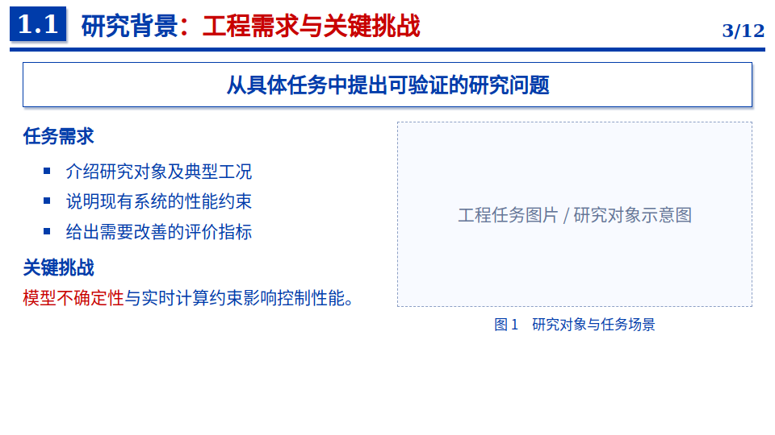
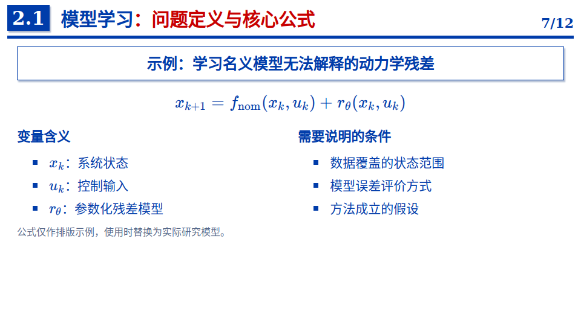
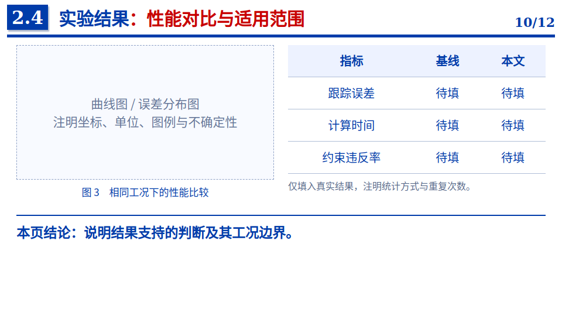

# 工科博士答辩 Slidev 模板与批改 Skill

面向工科博士学位论文答辩的演示模板与 AI 审查工具，覆盖研究主线、内容安排、证据呈现、页面布局和答辩准备。

**22 页完整汇报示例 + 12 页通用版式 · 微软雅黑 · 蓝红学术风格 · 自动页码 · 内容与版式综合审查**

模板源码、Skill 和使用说明均可直接在线查看。需要使用时，可克隆仓库运行。最新修改位于 `main` 分支。

## 最短使用路径

1. 打开[在线示例](docs/tomato-report.md)，先看完整汇报长什么样。
2. 复制或修改 [`template/slides.md`](template/slides.md)，把示例文字替换成自己的研究内容。
3. 在 `template` 目录运行：

```bash
npm ci
npm run dev
```

只想做一套简洁的通用幻灯片，可运行 `npm run dev:starter`。需要批改时，直接把 PPT、PDF 或页面图片交给 [`SKILL.md`](skills/thesis-defense-slide-review/SKILL.md)。

字体说明见 [`template/fonts/README.md`](template/fonts/README.md)。模板已指定微软雅黑并使用加粗字重；微软雅黑属于 Windows 系统字体，公开仓库不直接分发字体文件。

## 完整汇报示例：西红柿炒鸡蛋

默认打开模板即展示 **《面向口味一致性的西红柿炒鸡蛋配比协同调节方法研究》**。用一道熟悉的家常菜演示研究问题、方法机制、对照、消融和结论边界，共 22 页。

[在线浏览整套幻灯片](docs/tomato-report.md) · [PowerPoint 文件](template/examples/tomato/tomato-research.pptx) · [查看汇报源码](template/slides.md) · [查看示例说明](template/examples/tomato/说明.md)

汇报采用完整博士论文结构：研究背景与意义、国内外研究现状、研究目标与技术路线、主要研究工作、实验验证与结果分析、创新点与主要贡献、总结与展望。各部分均有对应内容页。

示例中的数值来自可复现教学模型，不是真实烹饪或试吃结果。附带 Python 程序、逐批数据和 SVG 图表。

```bash
cd template
npm ci
npm run dev
# 复现教学模型
python examples/tomato/simulate.py
# 切换至原通用版式
npm run dev:starter
```

## 项目包含什么

| 组成 | 作用 | 入口 |
| --- | --- | --- |
| Slidev 模板 | 默认完整汇报，另附通用版式 | [完整示例](template/slides.md) · [通用版式](template/starter.md) |
| 批改 Skill | 检查研究逻辑、贡献、证据、内容取舍与格式 | [SKILL.md](skills/thesis-defense-slide-review/SKILL.md) |
| 内容检查表 | 将学术演示要求转成可执行的审查动作 | [内容要求](docs/学术PPT内容要求.md) |
| 页面预览 | 直观查看封面与代表性内容页 | [预览图片](docs/images) |

适用于航空航天、控制、机器人、机械及相关工程方向，也可调整用于预答辩、开题、中期汇报和学术报告。不同场景应相应调整证据深度与章节安排。

## 页面预览

以下图片展示模板布局，页面中的文字、表格和公式可编辑。预览来自此前构建，章节号和页码仍显示旧字体；最新源码已统一指定微软雅黑。

| 封面 | 目录与章节过渡 |
| --- | --- |
|  |  |

| 背景与图文 | 公式与变量说明 |
| --- | --- |
|  |  |

**结果对比页**



## 答辩内容应讲清什么

一场完整答辩应让听众理解：研究为什么值得做、现有方法缺少什么、本人提出了什么、证据如何支持结论，以及方法适用于哪些条件。

### 全篇组织

| 环节 | 应回答的问题 | 建议呈现 |
| --- | --- | --- |
| 背景与动机 | 研究对象和工程任务是什么，现有做法有什么具体不足？ | 典型任务、约束、实际问题 |
| 研究现状 | 已有工作解决到什么程度，仍有什么缺口？ | 按能力与限制组织的对比 |
| 研究目标 | 本论文要解决哪些明确问题？ | 问题、目标和指标对应关系 |
| 总体方案 | 各项研究为什么属于同一篇论文？ | 总体路线、依赖关系或共同目标 |
| 主要工作 | 做了什么，关键设计为什么合理？ | 核心机制、必要公式、假设与条件 |
| 验证与讨论 | 怎样验证，结果意味着什么？ | 对照、工况、指标、统计与解释 |
| 总结与展望 | 本人贡献是什么，局限在哪里？ | 问题—贡献—证据对应表、后续方向 |

以上是组织参考，不规定统一页数或时间比例。先依据实际结果确定能支持的核心信息，再按答辩时长和听众背景决定讲述深度。

### 内容安排的 15 条要求

1. **全篇有明确核心信息。** 能用一句话说清希望评委记住的主要贡献。
2. **背景服务于具体问题。** 说明任务、困难和研究必要性，避免与论文贡献无关的宏观铺陈。
3. **研究现状导向明确缺口。** 按方法能力、假设或局限组织，不只堆作者、年份和论文名称。
4. **研究目标可以检查。** 将目标对应到问题、指标、理论性质或验证任务。
5. **多项工作有真实联系。** 解释共同目标或前后依赖；并列工作也要说明各自承担的角色。
6. **每页有一个主要观点。** 无法用一句话概括的页面，优先考虑拆页。
7. **标题能提示本页结论或问题。** 连读标题应能看出主线。封面、目录和过渡页按其功能命名。
8. **正文直接支持标题。** 图、公式和文字都应有明确作用，避免加入无关材料。
9. **方法讲清关键机制。** 说明输入、输出、设计理由及必要条件，保留理解贡献所需的技术深度。
10. **公式解释含义与用途。** 交代关键变量、物理意义、假设，以及公式在方法中承担的作用。
11. **结果页说明怎样读图。** 讲清坐标、单位、对照、关注信号和判断依据。
12. **图表适合现场阅读。** 放大重点、精简无关曲线和多子图，保留解释结论所需的信息。
13. **结论与证据逐项对应。** 定量提升写明基准、工况和统计口径，不超出验证范围。
14. **章节过渡说明承接关系。** 说明上一部分解决了什么、下一部分为什么必要。
15. **主讲与备份合理分工。** 长推导、参数表和扩展实验放备份页，并通过演练检查理解和时长。

### 章节内容与验收标准

模板中的章节不是占位目录。每一部分都要完成“主张—证据—承接”：

| 章节 | 必须讲清 | 常见不合格表现 |
| --- | --- | --- |
| 背景与意义 | 对象、场景、矛盾、指标，以及科学/工程价值 | 宏观口号多，听众不知道具体要解决什么 |
| 国内外现状 | 按问题或能力分类，说明已有能力、条件和缺口 | 按作者和年份罗列，没有形成研究问题 |
| 问题与目标 | 可检验的问题、目标、边界和 Q→W→V 映射 | “提高性能”但没有指标、条件或验收方式 |
| 技术路线 | 问题→理论/模型→方法→实现→验证的因果链 | 只有模块框图，模块之间没有输入输出和依赖 |
| 主要工作 | 每项按问题—方法—结果—小结展开，说明本人贡献 | 只讲方法名或只展示结果，无法判断为何有效 |
| 实验与结果 | 数据/工况、基线、指标、重复、统计口径和适用边界 | 只报最好值，仿真、硬件在环和实物实验混写 |
| 创新、总结与展望 | 每项贡献对应缺口和证据，局限对应可执行后续工作 | 用“首次/领先”替代证据，展望写成口号 |

详细到页面级的动作清单、时间分配和验收表见[《学术 PPT 内容要求》](docs/学术PPT内容要求.md)。这套要求参考高校学位答辩细则、研究生培养/开题要求和科研报告教程提炼，实际答辩仍以所在学校、学院和答辩通知为准。

以下按制作顺序展开。每个区块是内容任务，不强制对应一页；内容过多时拆页，不能通过缩小字体容纳。下面的句式均为填写框架，数字和结论必须来自实际研究。

#### 1. 研究背景与意义：从真实任务收束到具体矛盾

- **讲述顺序**：应用场景 → 研究对象与任务 → 实际约束 → 当前瓶颈 → 解决后的价值。
- **必须交代**：系统要完成什么任务；工作在什么环境；性能受什么限制；现有结果距离需求差多少。没有量化数据时，明确使用现象或需求描述，不能编造指标。
- **意义分层**：科学意义回答需要揭示什么机制或建立什么理论；工程意义回答改善什么性能、成本或可实现性。两者不必机械并列，但都要与实际工作对应。
- **推荐呈现**：一张对象/任务图，配一张需求与现状对照图或典型失败案例；关键瓶颈用红色标注。
- **总结句框架**：“在〔场景与约束〕下，〔现有瓶颈〕限制了〔任务指标〕，因此需要研究〔具体问题〕。”
- **验收问题**：外领域评委能否说清研究对象和必要性？删掉行业口号后，研究动机是否仍然成立？

#### 2. 国内外研究现状：把文献整理成缺口分析

- **先划范围**：说明综述围绕哪个问题、覆盖哪些方法；包含奠基工作及与本论文直接相关的新进展，避免只选支持自己观点的文献。
- **再建分类**：按技术路线、建模假设、信息条件或解决能力划分；国内外代表工作放在同一比较框架中。
- **逐类分析**：关键思路是什么、已经解决什么、依赖什么条件、仍存在什么限制；不足必须准确，不能把不适用场景写成方法本身错误。
- **统一比较维度**：按研究选取精度、鲁棒性、数据需求、计算量、约束处理或验证层级；未报告的信息标为“未报告”，不能擅自推断。
- **推荐呈现**：“方法类别｜代表工作｜关键机制｜成立条件｜剩余问题”表格；表格过宽时分成方法谱系页和缺口分析页。
- **总结句框架**：“已有方法能够〔已有能力〕，但在〔具体条件〕下仍难以〔待解决任务〕。”
- **验收问题**：缺口是否有文献依据？是否与后面的研究目标一一对应？是否避免“研究较少，因此创新”的推断？

#### 3. 研究问题与目标：让目标可以被验证

- **区分概念**：研究问题是尚未解决的矛盾；研究目标是要达到的结果；研究内容是为此开展的工作，三者不能互相替代。
- **问题定义**：明确对象、输入输出、扰动、已知/未知信息和约束；解释科学问题或关键技术难点为何不能由现有方案直接解决。
- **目标定义**：给出性能指标、理论性质或验证任务，并说明评价条件；目标值属于要求，最终结果另行报告。
- **边界定义**：说明研究覆盖和不覆盖的工况、数据分布、对象范围与假设；避免“全工况、通用、完全解决”等无证据表述。
- **推荐呈现**：“问题 Q｜目标 G｜研究工作 W｜验证 V”对应表；每项研究都有明确的验证出口。
- **总结句框架**：“本论文围绕〔核心问题〕，通过〔若干研究任务〕，在〔边界〕内验证〔目标〕。”
- **验收问题**：评委能否判断目标是否完成？每个目标是否有后文证据？关键困难是否具体到机制或约束？

#### 4. 总体技术路线：说明各项工作怎样组成整体

- **画出信息流**：从问题到模型、方法、实现和验证，标明关键输入、输出和反馈关系；不能只有装饰性箭头。
- **解释工作联系**：哪些工作提供模型、哪些负责决策或控制、哪些完成验证；并列工作如实说明共同目标，不虚构前后依赖。
- **区分来源与新增**：标出沿用的基础、论文提出的模块和验证平台，避免整张框图都被理解为本人创新。
- **说明设计理由**：为什么选这条路线，主要替代路线为何不适合当前条件；仅保留与研究选择有关的比较。
- **推荐呈现**：一张总路线图，当前研究部分可在章节过渡时高亮；模块名称与正文保持一致。
- **总结句框架**：“各项工作通过〔共享目标或依赖关系〕衔接，形成〔问题到验证〕的研究链条。”
- **验收问题**：每个模块是否有输入输出？是否存在没有验证的工作、没有目标的实验或突然出现的模块？

#### 5. 主要研究工作：每项都完成一次完整论证

- **问题页**：承接现状缺口，明确本项工作的任务、难点、约束及与前一工作的关系。
- **方法页**：先给总体思想，再展开关键机制；定义符号、物理意义、假设和设计理由，区分已有方法与新增部分。
- **理论页（适用时）**：写清命题、成立条件和结论的工程含义；主讲保留关键推理，完整证明放备份页。经验有效不能写成理论保证。
- **实现页（适用时）**：说明执行步骤、数据/传感器需求、参数来源、计算开销和部署条件，让评委判断能否实现。
- **验证与小结**：用针对性的实验检验本项主张；说明改善来自哪个机制、在哪些条件下成立、还存在哪些限制。
- **推荐呈现**：方法框图 + 必要核心公式 + 直接验证图；避免把完整推导、流程和多组结果硬塞一页。
- **总结句框架**：“针对〔难点〕，通过〔关键机制〕实现〔结果〕，其成立条件为〔边界〕。”
- **验收问题**：能否说明为什么有效、何时失效、如何实现？本人负责部分是否明确？

#### 6. 实验验证与结果分析：让每项结论都有对应证据

- **先给验证问题**：每组实验明确要验证哪个目标或主张，再介绍设置，避免实验图与研究问题脱节。
- **设置可追溯**：交代数据/工况来源、设备、采样与训练/测试划分、指标定义和单位、参数设置、重复次数；按研究类型选择适用项。
- **基线可解释**：包含相关的经典方法、具有竞争力的方法和必要的简单基线；说明选择原因及调参预算，不能故意使用弱配置。
- **对比公平**：数据、资源、约束和评价口径尽量一致；存在差异时说明差异及其对结论的影响。
- **实验覆盖**：按主张安排总体对比、消融、参数敏感性、扰动/泛化、效率和失败工况，不要求机械凑齐所有实验类型。
- **统计与读图**：标注坐标、单位、图例、样本数及误差条含义；适用时报告多次运行的均值/中位数与离散程度，单次实验如实注明。
- **解释结果**：区分观察到的现象、可能解释和已被验证的机制；相对提升注明基准与计算口径，同时报告必要的绝对值。
- **验证层级**：仿真、公开数据、硬件在环、台架和实物实验分别标明；讨论证据能支持到哪一级工程结论。
- **总结句框架**：“在〔工况、样本与资源条件〕下，相比〔基线〕，〔指标〕由〔值〕变为〔值〕，支持〔限定结论〕。”
- **验收问题**：证据能否直接支持标题？是否只挑最好结果？异常和失败是否交代？是否超出测试范围外推？

#### 7. 创新点与主要贡献：明确新增了什么

- **贡献逐项写实**：每项包含“针对的缺口—新增机制/理论/系统—支撑证据—适用范围”，不要只列算法或系统名称。
- **区分贡献性质**：理论性质、方法机制、工程实现和验证资源可分别表述；工作量、论文篇数与专利数量不能代替技术贡献。
- **说明已有基础**：指出沿用了什么、改了什么、为何该改变具有价值；合作工作明确本人角色。
- **推荐呈现**：“贡献 C｜对应问题 Q｜新增内容｜证据位置｜边界”对应表，证据可回指图、实验或定理。
- **总结句框架**：“本论文的主要新增在于〔具体做法〕，由〔证据〕支持其在〔条件〕下的〔价值〕。”
- **验收问题**：去掉“首次、显著、先进”后，贡献是否仍清楚？每项创新是否在正文中被解释和验证？

#### 8. 总结、局限与展望：回答做成了什么，还缺什么

- **总结回收目标**：按“研究问题—主要做法—核心结果—完成程度”逐项回答开头目标，不复述章节目录。
- **结论保持边界**：保留决定结论成立的条件，报告最有代表性的真实结果；总结页不能突然出现正文未证明的新结论。
- **局限说明影响**：明确数据、假设、工况、规模、计算或工程验证的限制，并说明这些限制会影响哪些结论。
- **展望给出路径**：每条后续工作对应当前局限，说明拟改变什么、怎样验证和预期解决什么问题；计划不能写成已完成成果。
- **推荐呈现**：总结用“目标—结果”表；局限与展望用“当前限制—下一步动作—验证方式”表，内容多时分两页。
- **总结句框架**：“本论文在〔边界〕内完成〔目标〕；下一步将通过〔动作与验证〕解决〔剩余问题〕。”
- **验收问题**：开头的问题是否全部得到回答？哪些已解决、部分解决或未解决是否清楚？下一步能否实际执行？

#### 页面制作与批改的统一出口

每张内容页都填写：**本页问题 → 主要证据 → 最先看到的重点 → 一句总结 → 与下一页的联系**。目录、封面和章节过渡页也保留明确的导航或承接句。提交前逐页检查文字是否清楚、重点是否突出、总结是否有证据；不合格时精简或拆页。

### 字号与每页重点的硬性要求

模板按投影答辩场景执行严格下限：标题不低于 30 pt，正文建议 22–26 pt，普通正文、表格、图注、图例、坐标轴和单位不低于 20 pt，关键数字和结论不低于 24 pt。页面放不下时必须删减、拆页、裁剪图表或移入备份页，不能把字缩小到看不清。

除封面、目录、章节过渡和致谢页外，每页必须有一个视觉重点和一句由证据支持的总结句。批改时逐页记录“最重要的视觉元素｜总结句｜最小字号”；任意一项缺失，页面都不能判为通过。

### 工科博士答辩的重点

- **对象与模型**：讲清坐标系、输入输出、工况、建模假设和边界条件。
- **理论与算法**：交代关键机制、成立条件、复杂度或实时实现条件。
- **实验与仿真**：区分仿真、硬件在环和实物验证，说明基线、参数、重复次数与评价指标。
- **结果与限制**：解释误差、不确定性、失败工况和适用边界。
- **本人贡献**：区分沿用方法、合作工作与本人新增部分，说明具体改进和证据。

### 单页自检

制作或修改一页之前，先填写这四项：

| 本页主要观点 | 支撑材料 | 与前后页的联系 | 主讲或备份 |
| --- | --- | --- | --- |
| 本页希望听众理解什么？ | 哪张图、哪个结果或公式支持它？ | 为什么此处需要这一页？ | 是否必须在主讲中展开？ |

例如，将“实验结果”改成“在给定扰动工况下，方法降低了跟踪误差”，正文用对应曲线和指标支撑。仅在实际结果支持时采用这种结论标题。

## 模板版式与视觉规范

模板采用 16∶9 画布，包含封面、目录、背景图文、研究现状表格、总体路线、章节过渡、核心公式、方法框图、三栏验证场景、结果对比、贡献总结和致谢，共 12 页通用版式，保存在 `starter.md`；默认 `slides.md` 为 22 页番茄炒蛋科研汇报。

| 元素 | 约定 |
| --- | --- |
| 普通文字 | 标题、正文、表格、图注、数字、章节号和页码统一指定微软雅黑 |
| 数学公式 | 使用 KaTeX 数学字体，保持上下标、希腊字母和算符正确 |
| 标题 | 深蓝色主标题，红色突出关键问题或结论 |
| 内容页 | 白底、蓝色章节编号、顶部横线和自动页码 |
| 目录页 | 左蓝右白，当前章节用红色标记 |
| 封面 | SVG 曲线装饰，可编辑题目、姓名、单位与日期 |

运行和导出设备需安装 **微软雅黑（Microsoft YaHei）**；模板普通文字默认使用加粗字重，保证投影场景下清晰。字体文件不随项目分发。外部位图中的文字需在制图源文件中调整；模板 CSS 无法替换图片内文字。

字号按标题、正文、图注分层，并在同层级保持一致。内容放不下时，先整理逻辑、精简或拆页。单位、缩写、颜色和符号在全篇保持一致。

## 快速开始

建议使用 Node.js 22.12 或更高版本。

```bash
git clone https://github.com/PaoShou-China/thesis-defense-slidev.git
cd thesis-defense-slidev/template
npm ci
npm run dev
```

在仓库根目录查看文件时，内容入口为 `template/slides.md`；进入 `template` 后，直接编辑 `slides.md`。

```bash
npm run build   # 构建静态网页，输出到 dist
npm run export  # 导出 PDF
```

首次导出如提示缺少浏览器，按终端提示安装 Playwright Chromium。构建产物需通过 HTTP 服务访问。

### 设置内容页

```md
---
section: '2.1'
heading: 模型高效学习
emphasis: 基础科学问题
---

本页内容
```

`section` 设置章节号，`heading` 设置蓝色标题，`emphasis` 设置红色重点。页码与总页数自动计算。

### 设置封面

```yaml
layout: cover
presenter: 答辩人：姓名
institute: 所在单位：学院
supervisor: 指导教师：姓名教授
date: 20XX 年 X 月 · 北京
```

### 插入图片和公式

在 `template` 中建立 `public` 目录并放入图片，例如 `public/experiment.png`：

```html

```

公式使用标准 LaTeX：

```latex
$$
x_{k+1}=f(x_k,u_k)
$$
```

页面可使用 `cols-2`、`cols-3` 组织两栏或三栏；`banner` 用于突出主旨；`figure` 表示图片区域；`caption` 表示图注；`takeaway` 表示本页结论。具体写法见模板示例。

## 使用批改 Skill

Skill 文件夹为 `skills/thesis-defense-slide-review/`。将整个文件夹复制到所用工具的 Skills 目录，例如 Codex 的 `~/.codex/skills/`，并按工具要求加载。也可以直接将 [SKILL.md](skills/thesis-defense-slide-review/SKILL.md) 作为审查指令提供给 AI。

### 建议提供的材料

| 材料 | 用途 |
| --- | --- |
| PPTX、PDF 或页面图片 | 审查内容与版面 |
| 答辩时长与汇报场景 | 判断内容取舍和讲述负担 |
| 论文、摘要或贡献说明 | 核对幻灯片主张与论文是否一致 |
| 学校模板与明确要求 | 检查必须遵循的格式 |
| 实验材料或结果说明 | 核对指标、工况与结论 |

只有幻灯片也可以审查；缺少依据的技术问题会标为待核实。

### 调用示例

**综合批改**

> 使用 $thesis-defense-slide-review 审查这份工科博士答辩幻灯片。答辩时长 30 分钟，先检查研究主线、内容安排与证据，再给逐页修改建议。

**调整内容顺序**

> 重点检查几项研究工作之间的关系，给出建议目录和逐页故事板，并说明哪些内容适合放入备份页。

**直接修改**

> 按审查结果直接修改幻灯片，统一微软雅黑，优化标题与内容顺序。保留真实数据和技术含义，将需要作者核实的事项单独列出。

### 批改输出

| 输出 | 内容 |
| --- | --- |
| 总体判断 | 主线是否成立，最大问题是什么 |
| 优先修改清单 | 按影响程度安排修改顺序 |
| 逐页意见 | 页码、问题、影响、具体改法 |
| 目录与故事板 | 必要时调整章节和页面顺序 |
| 答辩追问 | 假设、基线、归属、边界与工程实现等问题 |
| 格式与时间检查 | 阅读负担、投影可读性、公式图表和讲述时长 |

修改意见分为 **P0 必须修正**、**P1 优先修改**、**P2 可选优化**。默认输出意见；明确要求改稿时再修改文件。

## 推荐工作流程

1. 从论文中提取核心问题、本人贡献和支撑证据。
2. 写出全篇核心信息及各页标题，检查研究主线。
3. 用模板填入方法、结果与必要背景，规划备份页。
4. 使用 Skill 审查，优先修正证据、逻辑和内容安排。
5. 统一字体、图表和符号，检查实际导出效果。
6. 进行计时演练，根据听众反馈调整页面与过渡。

## 项目结构

| 路径 | 用途 |
| --- | --- |
| `template/slides.md` | 22 页番茄炒蛋科研汇报 |
| `template/starter.md` | 12 页通用版式 |
| `template/examples/tomato/` | 教学程序、数据及说明 |
| `template/public/tomato/` | 原创插图与数值图表 |
| `docs/tomato-report.md` | 完整汇报的在线预览 |
| `template/style.css` | 配色、字体、字号和布局 |
| `template/layouts/default.vue` | 普通内容页 |
| `template/layouts/cover.vue` | 封面与致谢 |
| `template/layouts/agenda.vue` | 目录与章节过渡 |
| `template/使用说明.md` | 简要操作说明 |
| `skills/thesis-defense-slide-review/SKILL.md` | Skill 核心流程 |
| `skills/thesis-defense-slide-review/references/` | 详细内容检查规则 |
| `docs/学术PPT内容要求.md` | 内容规范入口 |
| `docs/images/` | 页面预览图片 |

## 常见问题

**是否必须使用 Slidev？**

模板使用 Slidev。批改 Skill 的内容规则也适用于 PowerPoint、PDF 和页面图片。

**为什么设备上显示的字体不一样？**

先确认该设备安装了微软雅黑。缺少字体时，浏览器可能自行回退；导出前需检查最终设备上的显示效果。

**所有内容都要放进主讲吗？**

按贡献、证据与时间取舍。决定结论是否成立的条件应讲清，次要推导、完整参数和扩展实验可放备份页。

**是否有固定页数或每页字数要求？**

项目不设统一硬性数量。依据学校要求、技术复杂度、阅读负担和计时演练结果调整。

**如何处理过长标题和拥挤页面？**

先提炼主要观点，删除重复内容或拆页。保持标题、正文、图注的层级，不通过持续缩小字号容纳所有材料。

**可以直接使用示例中的研究结论吗？**

示例文字、公式和数据表用于展示版式，请替换为真实材料，补齐实际研究所需的引用、单位、工况与统计说明。

**这是否是学校官方模板？**

这是通用工科学术模板。学校的封面、标志、保密与答辩格式要求应单独核对。

**如何获取最新修改？**

查看或拉取 `main` 分支。已有的 `v1.0.0` Release 是此前发布的快照。

## 验证状态

模板已通过 Slidev 52.20.1 生产构建，依赖由 `package-lock.json` 固定。Skill 已通过结构校验。当前运行环境未安装微软雅黑，最新字体尚未完成实际渲染验收；README 预览图保留此前的布局展示。
