# 西红柿炒鸡蛋科研汇报示例

完整 16 页，直接向下浏览即可。[下载 PowerPoint 文件](../template/examples/tomato/tomato-research.pptx)。源文件位于 [slides.md](../template/slides.md)，在模板目录执行 `npm run dev` 可播放。

数值来自附带脚本的教学模型，不是真实烹饪实验。预览环境未安装微软雅黑，图片使用了系统回退字体；源码统一指定微软雅黑，实际播放与导出请安装该字体。

## 01　题目：面向口味一致性的配比协同调节

## 02　汇报提纲

## 03　研究背景：同配方与不同批次

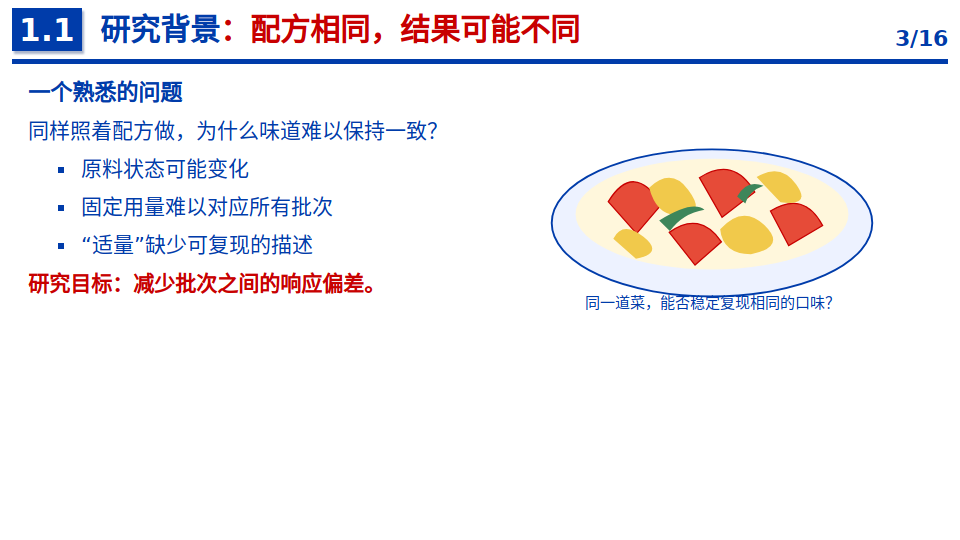

## 04　研究现状：配料变化与证据

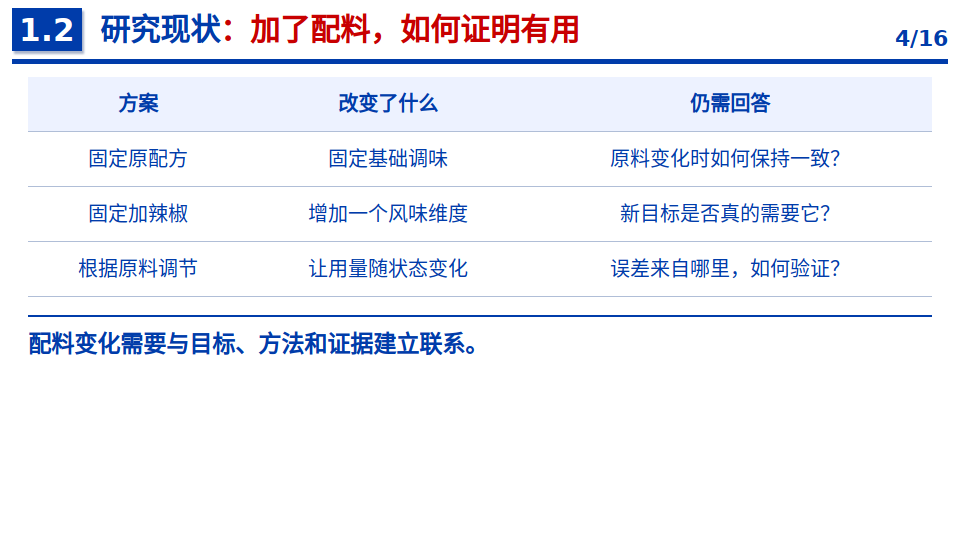

## 05　问题定义：明确目标与指标

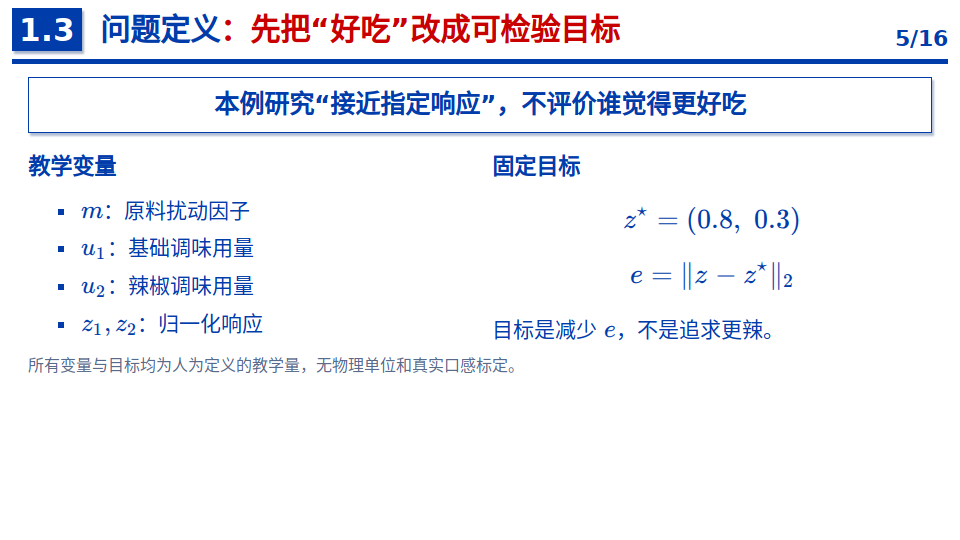

## 06　总体思路：状态驱动的配方

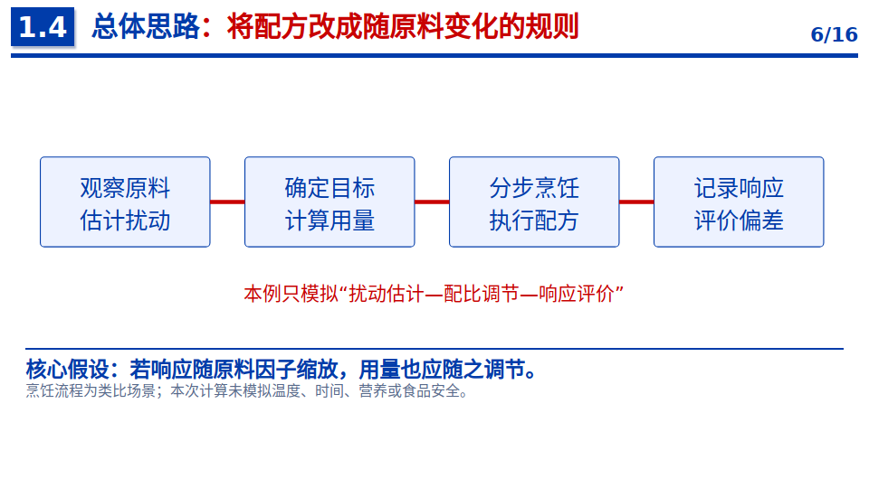

## 07　进入方法与验证

## 08　教学模型：用量与响应

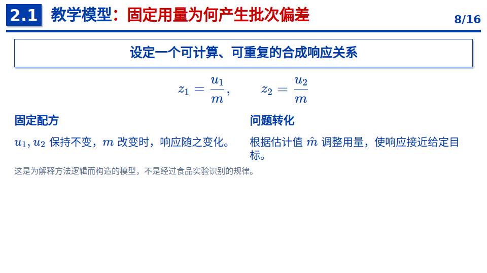

## 09　方法设计：双通道协同调节

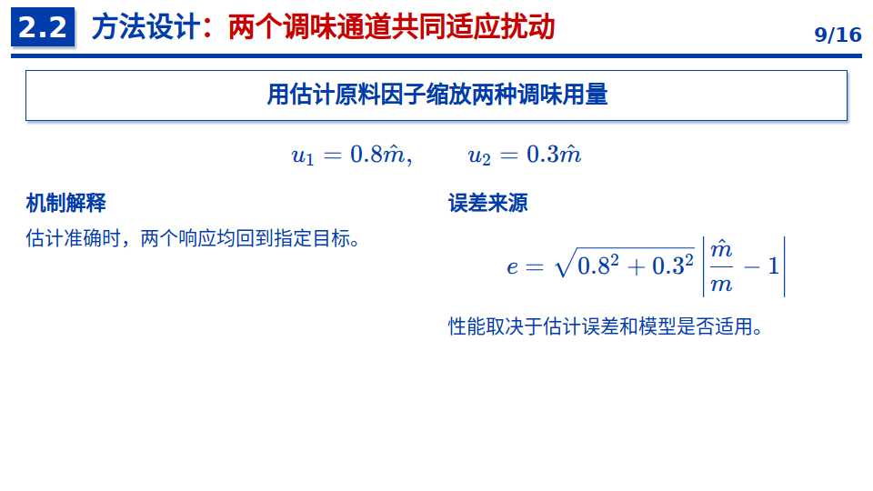

## 10　实验设计：相同批次公平比较

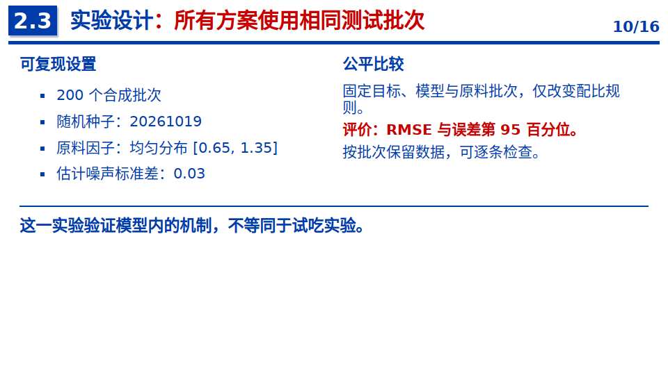

## 11　对比结果：不同方案的误差

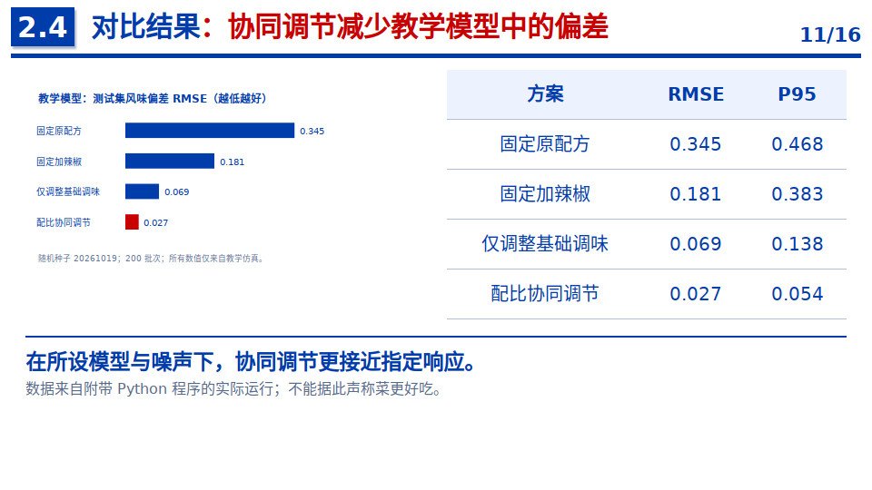

## 12　消融分析：各通道的作用

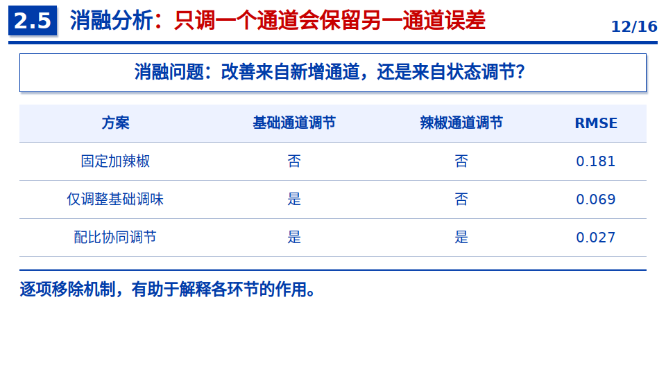

## 13　扰动分析：误差随原料变化

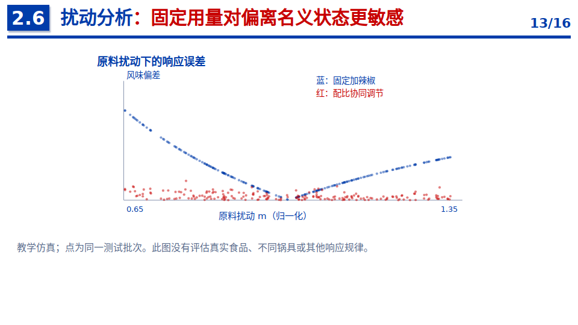

## 14　讨论：真实验证与边界

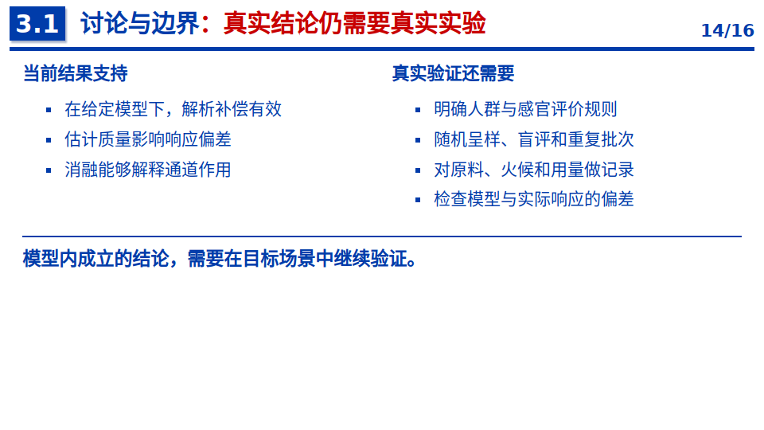

## 15　总结：问题、机制与证据

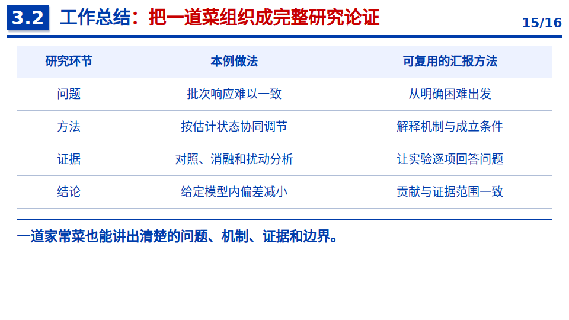

## 16　提问与交流

## 复现实验

[查看程序与实验说明](../template/examples/tomato/说明.md) · [逐批数据](../template/examples/tomato/results.csv) · [汇总指标](../template/examples/tomato/summary.json)
