# 西红柿炒鸡蛋科研汇报示例

完整 22 页，直接向下浏览即可。[下载 PowerPoint 文件](../template/examples/tomato/tomato-research.pptx)。源文件位于 [slides.md](../template/slides.md)，在模板目录执行 `npm run dev` 可播放。

数值来自附带脚本的教学模型，不是真实烹饪实验。预览环境未安装微软雅黑，图片使用了系统回退字体；源码统一指定微软雅黑，实际播放与导出请安装该字体。

## 01　汇报题目

## 02　博士论文汇报提纲

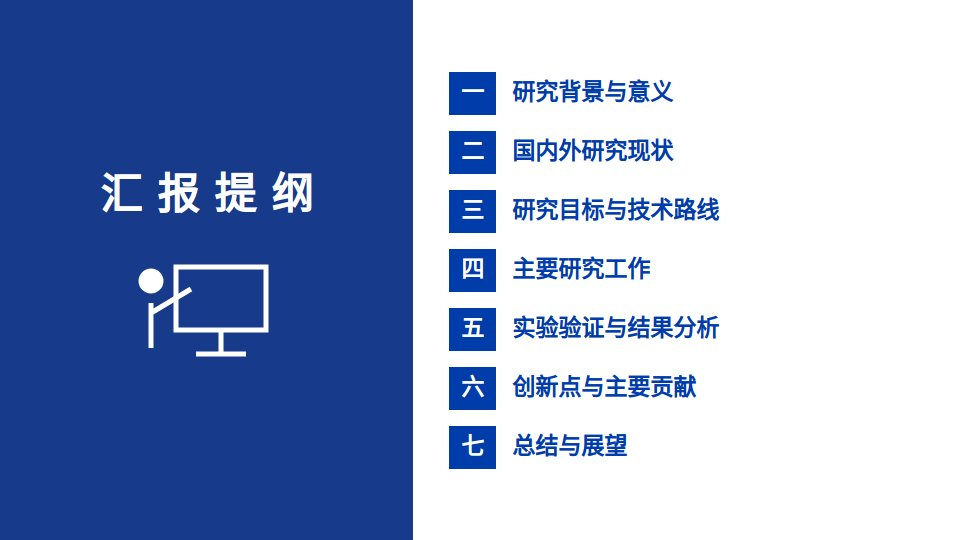

## 03　研究背景：配方相同，结果可能不同

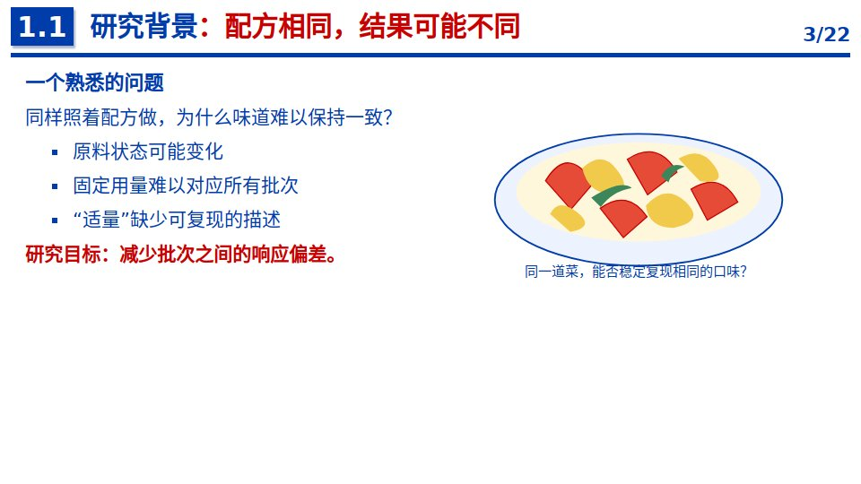

## 04　研究意义：从一次成功走向稳定复现

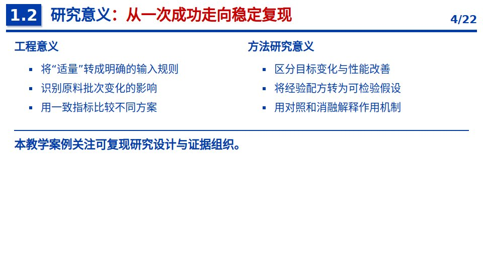

## 05　国内外研究现状：按方法能力组织研究脉络

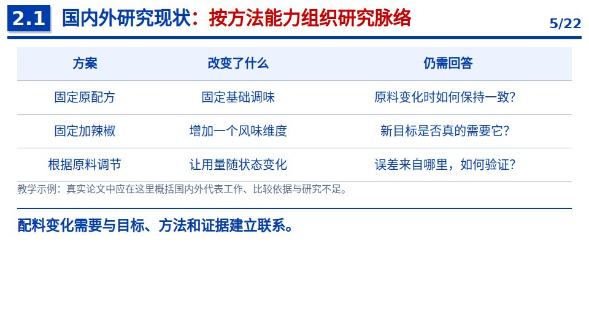

## 06　现有不足：从方案比较凝练研究问题

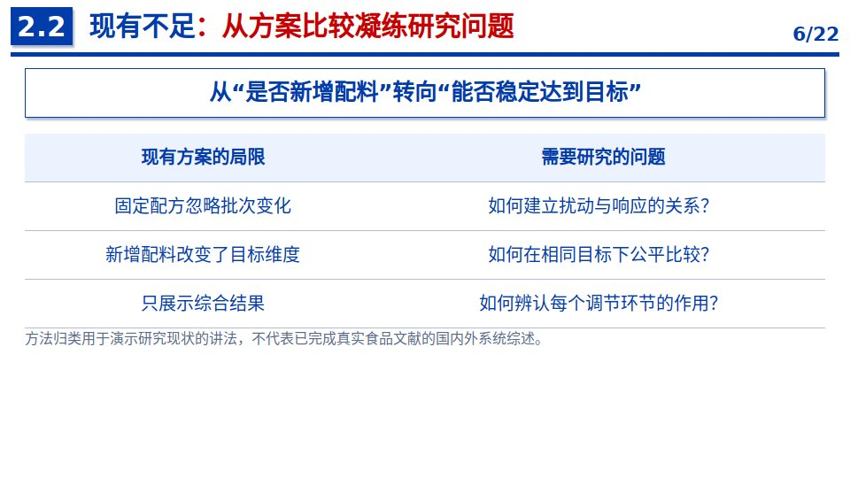

## 07　研究目标与内容：以响应一致性串联研究任务

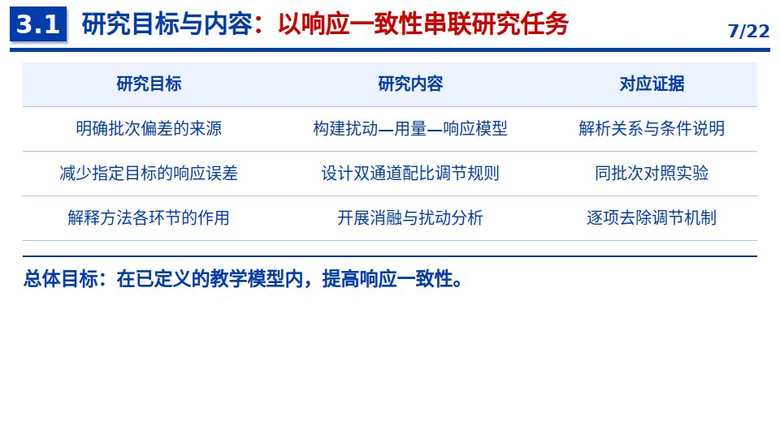

## 08　问题定义：先把“好吃”改成可检验目标

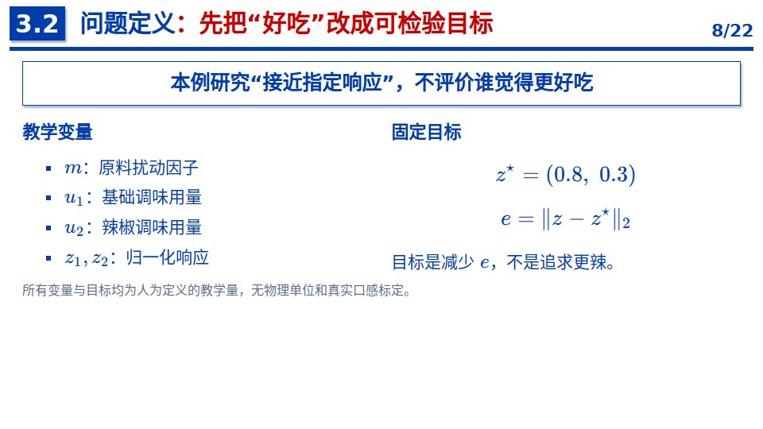

## 09　总体技术路线：将配方改成随原料变化的规则

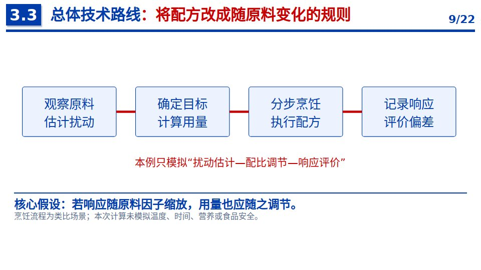

## 10　博士论文汇报提纲

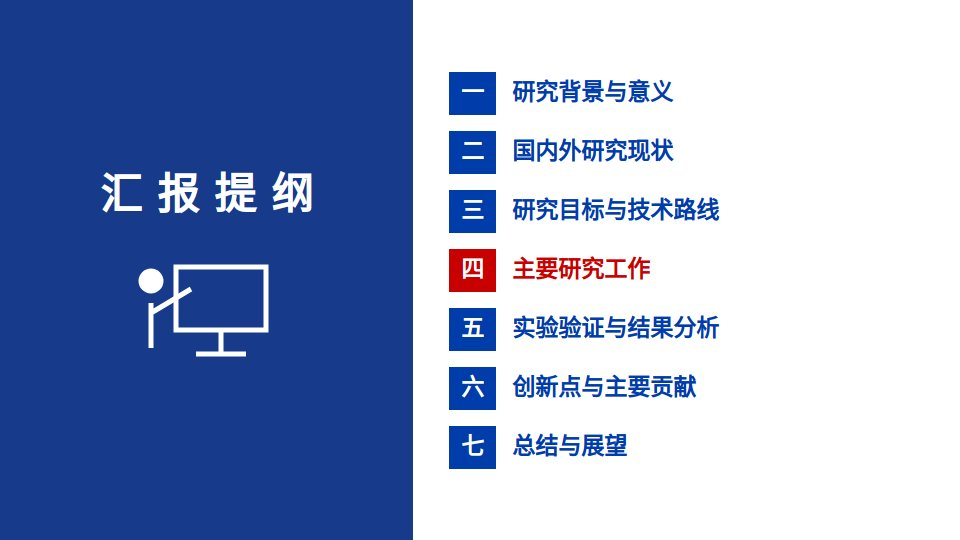

## 11　研究工作一：扰动与响应的模型描述

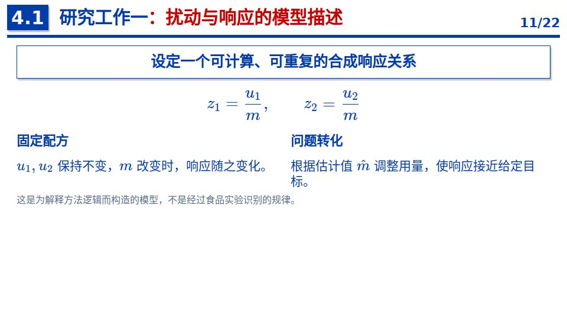

## 12　研究工作二：双通道配比调节方法

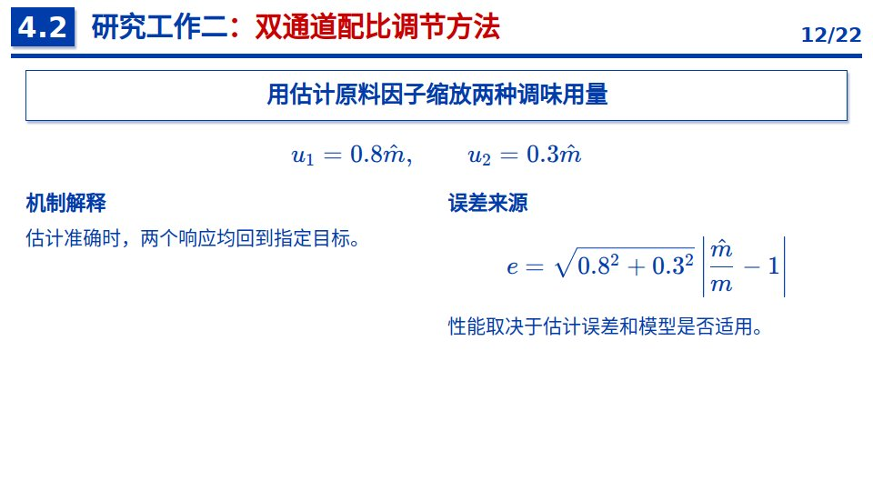

## 13　博士论文汇报提纲

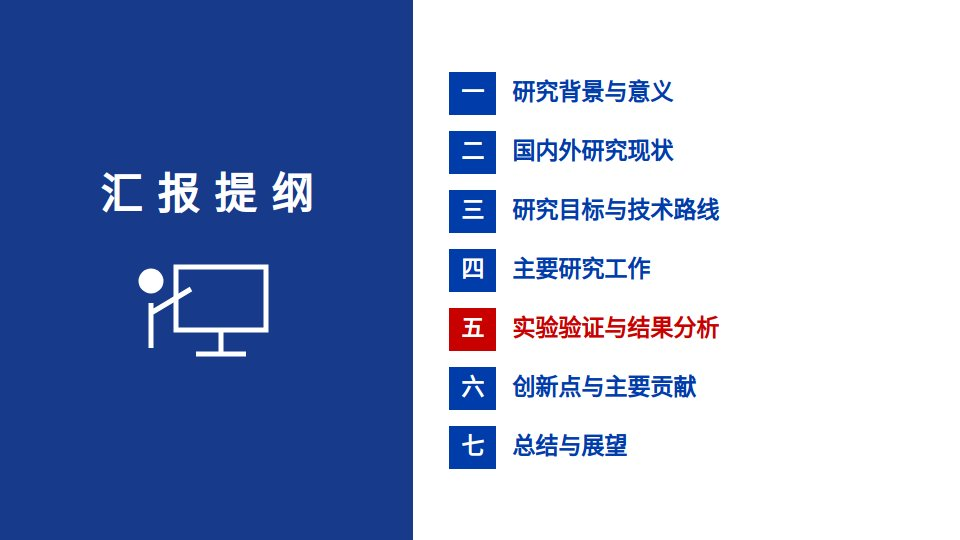

## 14　实验设置：所有方案使用相同测试批次

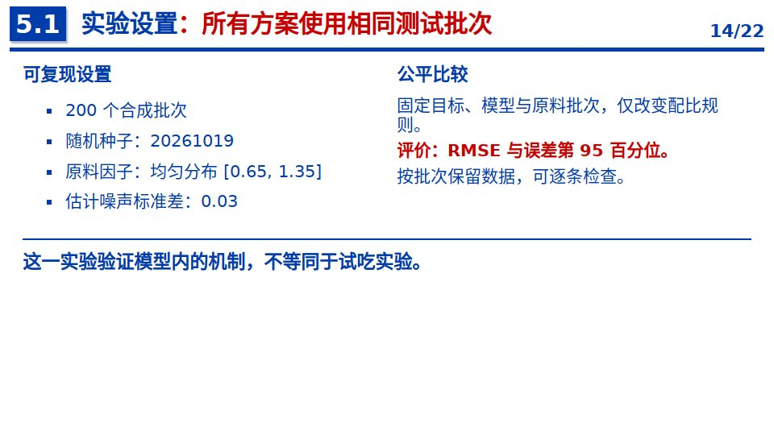

## 15　对比实验：协同调节减少教学模型中的偏差

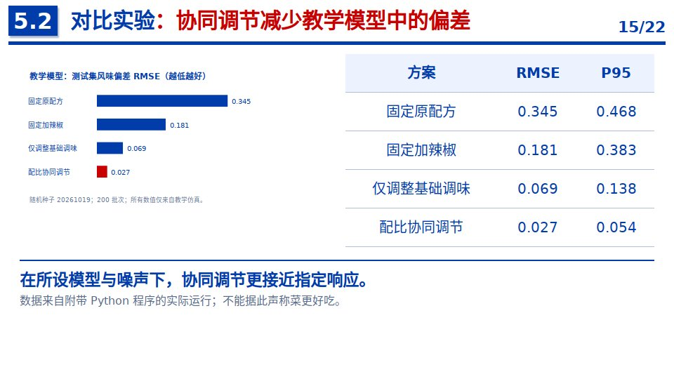

## 16　消融实验：只调一个通道会保留另一通道误差

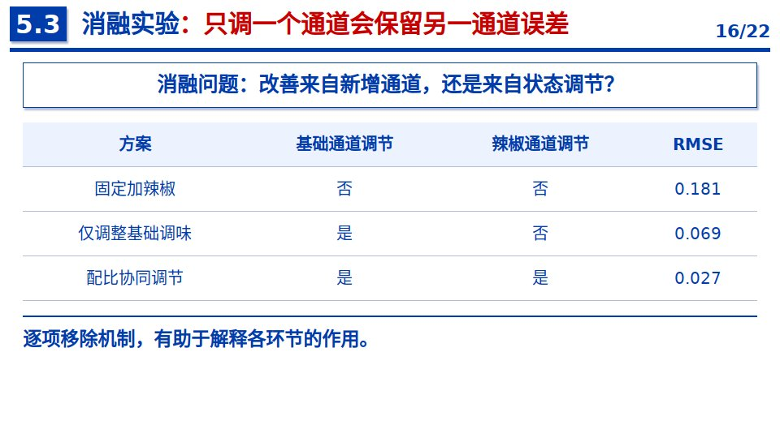

## 17　扰动分析：固定用量对偏离名义状态更敏感

## 18　创新点与主要贡献：问题、方法和证据逐项对应

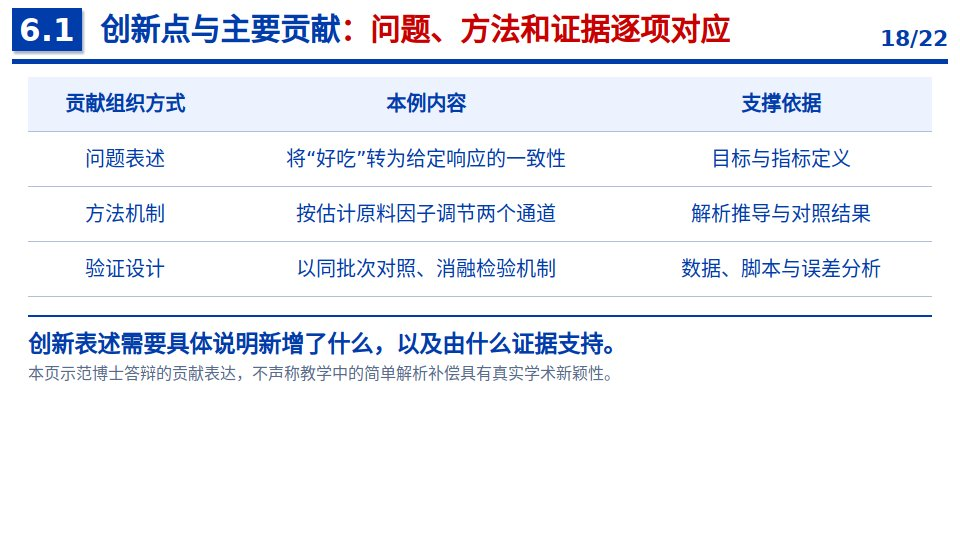

## 19　研究局限：模型结论与真实实验的距离

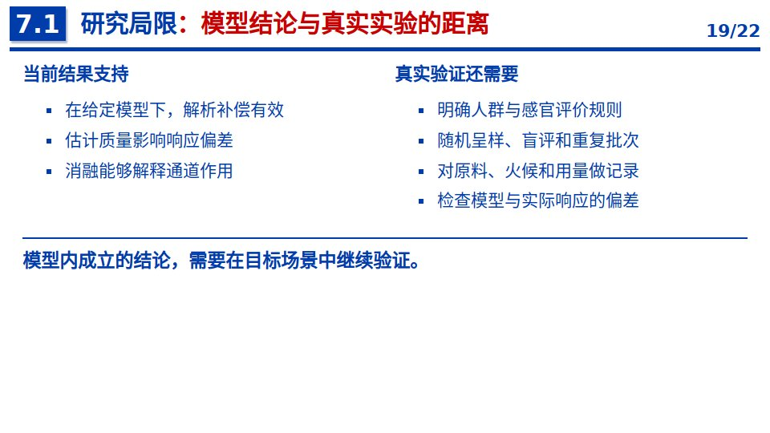

## 20　研究总结：把一道菜组织成完整研究论证

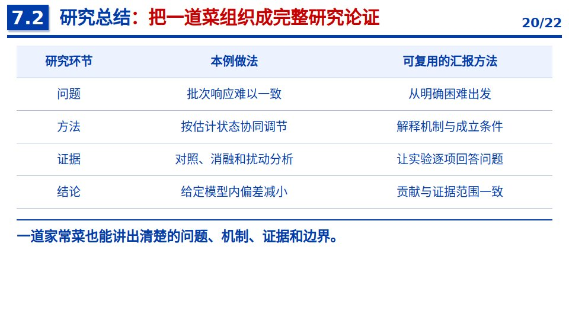

## 21　研究展望：从教学模型迈向真实问题

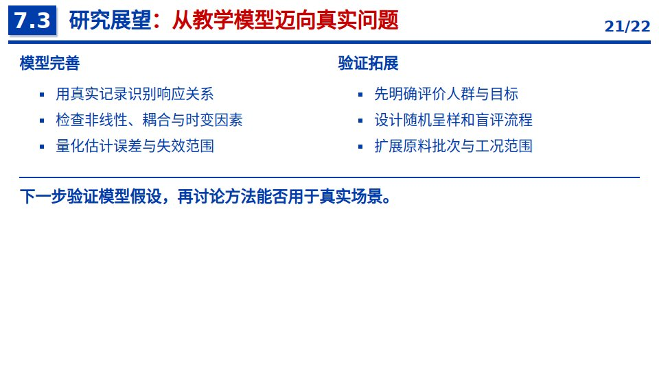

## 22　致谢

## 复现实验

[程序与实验说明](../template/examples/tomato/说明.md) · [逐批数据](../template/examples/tomato/results.csv) · [汇总指标](../template/examples/tomato/summary.json)
